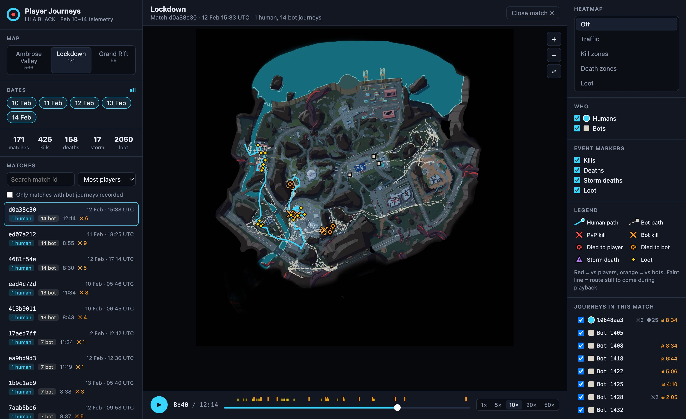

# LILA BLACK · Player Journeys

A web tool for level designers to see how people actually play LILA BLACK maps. It shows where players walk, fight, loot and die, replays any match on the real minimap, and has heatmaps for traffic, kill zones and death zones.

**Live:** https://lila-player-journeys-two.vercel.app



## What it does

| Need | How |
|---|---|
| Player journeys on the correct minimap | Paths drawn in world coordinates mapped to each map's minimap (see [ARCHITECTURE.md](ARCHITECTURE.md#coordinate-mapping)) |
| Humans vs bots | Humans: solid cyan line, round head with a white ring. Bots: dashed grey line, square head. Both can be toggled. |
| Event markers | PvP kill, bot kill, died to player, died to bot, storm death and loot each have their own shape and colour. Hover any marker for who, when and world x/z. |
| Filters | Map, any combination of dates (Feb 10–14), match search, sort (most players / most kills / longest / chronological), and "only matches with bot journeys recorded" |
| Timeline playback | Play/pause, 1–50× speed, scrubbing, event ticks on the timeline (click to jump), space and ←/→ shortcuts |
| Heatmaps | Traffic, kill zones, death zones and loot, over all filtered matches or the open match. They follow the date and human/bot filters, with the top-5 hotspots labelled with world coordinates. |
| Shareable | Every view is in the URL, e.g. `?map=Lockdown&heat=deaths&days=2026-02-12` |

## Tech stack

- **Preprocessing:** Python 3.10+, pyarrow, pandas, Pillow (`scripts/preprocess.py`)
- **App:** Vite 6, React 18, TypeScript, HTML canvas (no map or chart libraries)
- **Tests:** Vitest (coordinate mapping)
- **Hosting:** Vercel (static)

## Setup

```bash
# 1. Python env for the one-off data build
python3 -m venv .venv
.venv/bin/pip install -r requirements.txt

# 2. Turn the parquet folder into static JSON + WebP minimaps (writes ./public)
.venv/bin/python scripts/preprocess.py --src ../player_data --out public

# 3. Run the app
npm install
npm run dev          # http://localhost:5173
npm test             # coordinate mapping tests
npm run build        # static site in ./dist
```

`public/data` and `public/minimaps` are committed, so steps 1–2 are only needed when the data changes. `--src` must point to the folder that contains `February_10/ … February_14/` and `minimaps/`. That folder is only read.

### Environment variables

None. The app is fully static and reads its data from `/data/*.json`.

### Deploy

Import the repo in Vercel and deploy with the defaults. `vercel.json` sets the build command (`npm run build`), the output directory (`dist`) and cache headers.

## Walkthrough

1. **Pick a map** at the top left. The counter under each name is its match count. Ambrose Valley has 566, Lockdown 171 and Grand Rift 59.
2. **Narrow the dates** with the day chips, then turn on **Only matches with bot journeys recorded**. Most matches hold a single human journey, and these 52 are the ones that are interesting to replay.
3. **Open a match.** The whole match is drawn at once: faint lines for the full route, bold lines for the part already travelled. Click **▶** to replay it from the start. The ticks above the scrubber are kills, deaths and loot; click one to jump to it.
4. **Inspect** by hovering markers and player heads. The right panel lists every journey in the match with kills, loot and how and when they died. Hover a row to highlight that path, untick a row to hide it, or click a head on the map.
5. **Heatmaps** are in the right panel. *Traffic* shows where time is spent, *Kill zones* where kills happen and *Death zones* where players die. Untick **Bots** to see only human behaviour. With a match open, switch the heatmap between *All filtered matches* and *This match*. The hotspot list gives world coordinates for the five hottest spots.
6. **Share:** copy the URL. It carries the map, match, playback time, heatmap and dates.

The bottom-left of the map shows world x/z under the cursor, so you can read positions straight back into the editor.

## Repo layout

```
scripts/preprocess.py   parquet → JSON + WebP (the only place parquet is read)
scripts/insights.py     reproduces the numbers in INSIGHTS.md
src/lib/coords.ts       world ↔ minimap mapping (+ coords.test.ts)
src/lib/heatmap.ts      client-side binning, blur, colour ramps, hotspots
src/components/         MapCanvas (rendering + pan/zoom/hover), Timeline, Legend
src/App.tsx             filters, state, URL sync, playback loop
public/data, public/minimaps   generated assets
```

## Docs

- [ARCHITECTURE.md](ARCHITECTURE.md): stack, data flow, coordinate mapping, assumptions, tradeoffs
- [INSIGHTS.md](INSIGHTS.md): three findings from using the tool
